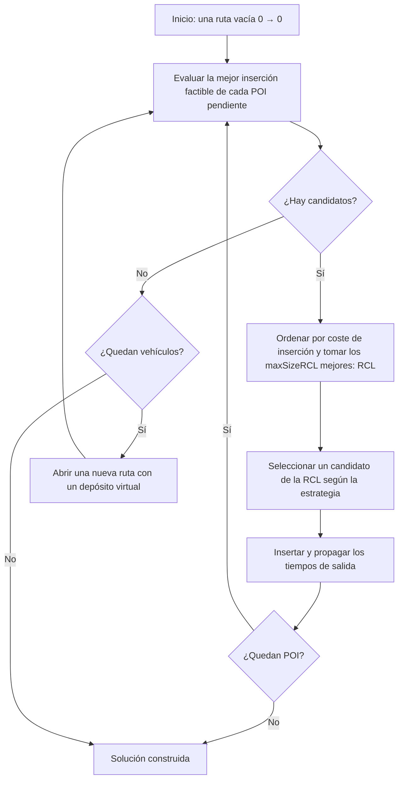

# Algoritmo GRASP

## El problema

Se dispone de *m* rutas (días). Cada ruta sale del depósito en el instante 0 y debe volver
antes de `T_max` (cierre de la ventana del depósito). Cada POI *i* tiene una puntuación
`S_i`, una duración de visita `d_i` y una ventana `[O_i, C_i]`: la visita puede empezar como
pronto en `O_i` (si se llega antes, se espera) y debe empezar estrictamente antes de `C_i`.
Se busca un conjunto de rutas que **maximice la suma de puntuaciones** visitando cada POI
como mucho una vez.

## Esquema general



`grasp(maxIterations, maxSizeRCL)` repite esta construcción `maxIterations` veces y registra
la puntuación media y la mejor. El esqueleto deja preparado un punto de extensión para una
fase de búsqueda local, que el proyecto original no implementa.

## Evaluación de una inserción

`comprehensiveEvaluation` prueba cada POI pendiente en cada posición de cada ruta abierta.
Insertar el candidato *c* entre `pre` y `suc` es factible si:

1. Se llega a *c* antes de su cierre: `salida(pre) + dist(pre, c) < C_c`.
2. La salida de *c*, `max(llegada, O_c) + d_c`, no supera `T_max`.
3. Tras el retraso que provoca la inserción, cada nodo posterior de la ruta, hasta volver al
   depósito, sigue cumpliendo su ventana y la duración máxima.

El **coste** de la inserción es la hora de regreso al depósito. Para cada POI se conserva su
posición de menor coste; el resultado es la lista de candidatos `{cliente, ruta, predecesor,
coste, puntuación}`.

En la versión refactorizada, la comprobación de un nodo está en `departureTime()` y la de una
posición completa en `insertionCost()`, lo que reduce la complejidad cognitiva de
`comprehensiveEvaluation` sin cambiar el resultado.

## Lista restringida de candidatos (RCL)

Los candidatos se ordenan por coste creciente y la RCL la forman los `maxSizeRCL` primeros. El
experimento usa tamaños 3, 5 y 7: cuanto mayor, más diversidad y menos voracidad.

## Estrategias de selección

| Estrategia | Regla |
|---|---|
| `RANDOM` | Uniforme sobre la RCL |
| `FUZZY_BEST` | El candidato con menor grado de pertenencia μ (mayor puntuación) |
| `FUZZY_ALPHA_CUT` *(por defecto)* | Uniforme entre los candidatos con μ ≤ α; si no hay ninguno, uniforme sobre la RCL |

El grado de pertenencia borroso de un candidato es

**μ(c) = 1 − S<sub>c</sub> / max<sub>i</sub> S<sub>i</sub>**

de modo que los POI más interesantes tienen μ cercano a 0. Con α = 0,8 solo se eligen POI cuya
puntuación sea al menos el 20 % de la máxima, siempre que haya alguno en la RCL. Así la
construcción combina el criterio temporal (la RCL se forma por coste) con el interés turístico
(la selección favorece la puntuación).

## Actualización tras insertar

`updateSolution` enlaza el POI en la lista doblemente enlazada y recorre la ruta desde el
predecesor recalculando los tiempos de salida de los nodos siguientes:

```text
t ← salida(pre)
repetir
    suc ← sucesor(pre)
    t ← max(t + dist(pre, suc), O_suc) + d_suc
    salida(suc) ← t
    pre ← suc
hasta volver al depósito
```

## Complejidad

Cada evaluación completa cuesta O(P · L · L) en el peor caso (P POI pendientes, L longitud
de las rutas), y se repite tras cada inserción, por lo que una construcción cuesta del orden de
O(P² · L²). Para las instancias de 100 POI una construcción tarda unos milisegundos.
