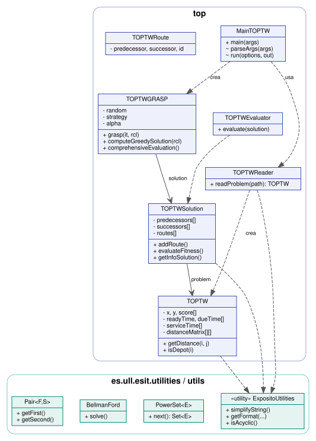
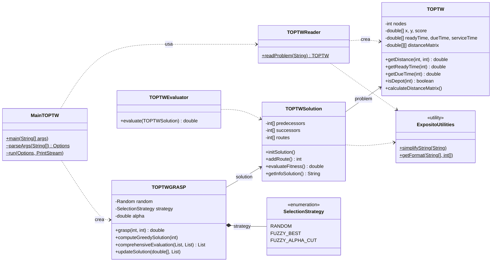
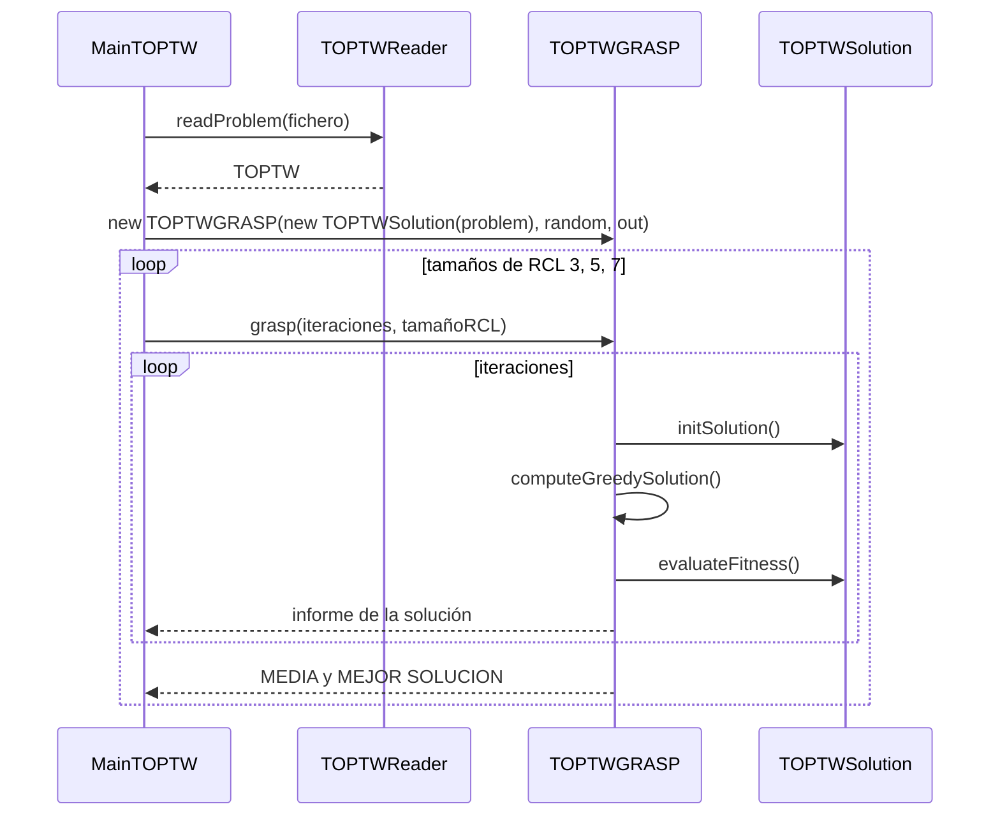

# Arquitectura

## Visión general

El proyecto es una aplicación Java de consola sin dependencias externas, organizada en tres
paquetes:

| Paquete | Contenido |
|---|---|
| `top` | Dominio del problema y algoritmo: modelo, lector, solución, evaluador, GRASP y programa principal |
| `es.ull.esit.utilities` | Utilidades genéricas: formato de tablas, ficheros, conjunto potencia, Bellman-Ford |
| `es.ull.esit.utils` | Tipos auxiliares (`Pair`) |

## Diagrama de clases

## Responsabilidades

**`TOPTW`** — Datos de la instancia. Guarda en vectores indexados por nodo las coordenadas,
la puntuación, la ventana temporal y la duración de la visita, y precalcula la matriz de
distancias euclídeas. Cualquier índice mayor que el número de POI se considera un depósito
virtual y se traduce internamente al nodo 0.

**`TOPTWReader`** — Convierte un fichero de instancia en un objeto `TOPTW`. Lanza
`IOException` ante ficheros inexistentes, truncados o mal formados (antes llamaba a
`System.exit(0)`).

**`TOPTWSolution`** — Representa las rutas con dos vectores, `predecessors` y `successors`,
que forman una lista doblemente enlazada circular por ruta. `routes[k]` guarda el depósito
de la ruta *k*. Insertar un POI tras otro es O(1).

**`TOPTWGRASP`** — Fase constructiva del GRASP (ver [Algoritmo](algoritmo.md)). El generador
aleatorio y el flujo de salida se inyectan en el constructor, lo que permite tests
reproducibles y usar la clase sin consola.

**`TOPTWEvaluator`** — Calcula la función objetivo (suma de puntuaciones) y la guarda en la
solución.

**`MainTOPTW`** — Interpreta los argumentos y ejecuta el experimento.

## Representación de una solución

Con 100 POI y 2 rutas, `0 → 5 → 3 → 0` y `101 → 43 → 101` se almacenan así:

| Nodo | 0 | 3 | 5 | 43 | 101 |
|---|---|---|---|---|---|
| `successors` | 5 | 0 | 3 | 101 | 43 |
| `predecessors` | 3 | 5 | 0 | 101 | 43 |

`routes = [0, 101, -1, …]`. Recorrer la ruta *k* es seguir `successors` desde `routes[k]`
hasta volver a él.

## Flujo de una ejecución

## Dependencias externas

En ejecución, ninguna. En construcción, JUnit 4.13.2 (tests) y los plugins de Maven descritos
en [Plugins configurados](maven/plugins.md).
