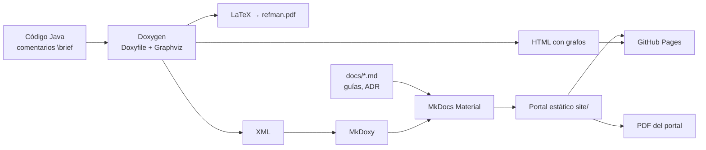

# Documentación: Doxygen + MkDocs (Docs-as-Code)

La documentación sigue el paradigma **Docs-as-Code**: se escribe en texto plano (comentarios
en el código y Markdown), se versiona en Git junto al código, se revisa en los *pull requests*
y se construye y publica automáticamente en cada cambio.



## 1. Comentarios en el código

Todas las clases, métodos y atributos tienen un comentario con una **descripción breve**
(`\brief`) y, cuando aporta, una **descripción detallada** (`\details`), además de `@param`,
`@return` y `@throws`:

```java
/**
 * \brief Coste de insertar un candidato justo después de un nodo de una ruta.
 *
 * \details Comprueba la ventana temporal del candidato, la del sucesor y la de todos
 * los nodos siguientes hasta volver al depósito, así como la duración máxima de ruta.
 *
 * @param routeIndex     ruta donde se inserta.
 * @param pre            nodo tras el que se inserta.
 * @param candidate      POI candidato.
 * @param departureTimes tiempos de salida por ruta y nodo.
 * @return tiempo de llegada al depósito tras la inserción, o NaN si no es factible.
 */
```

Cada paquete se documenta en su `package-info.java` y la página principal de Doxygen es
`doxygen/mainpage.md`.

## 2. Doxyfile

Opciones relevantes (el fichero completo está en la raíz del repositorio):

| Opción | Valor | Motivo |
|---|---|---|
| `OPTIMIZE_OUTPUT_JAVA` | `YES` | Presentación adaptada a Java (paquetes en lugar de *namespaces*) |
| `JAVADOC_AUTOBRIEF` | `YES` | Si falta `\brief`, la primera frase hace de resumen |
| `EXTRACT_ALL` / `EXTRACT_PRIVATE` / `EXTRACT_PACKAGE` | `YES` | Documenta también miembros privados y de paquete (documentación para mantenimiento) |
| `OUTPUT_LANGUAGE` | `Spanish` | Textos generados en castellano |
| `SOURCE_BROWSER`, `REFERENCED_BY_RELATION`, `REFERENCES_RELATION` | `YES` | Código navegable y referencias cruzadas |
| **`HAVE_DOT`** | **`YES`** | **Usa Graphviz para los grafos** |
| `CLASS_GRAPH`, `COLLABORATION_GRAPH`, `UML_LOOK` | `YES` | Diagramas de herencia y colaboración en estilo UML |
| `CALL_GRAPH`, `CALLER_GRAPH` | `YES` | Grafos de llamadas de cada método |
| `GRAPHICAL_HIERARCHY`, `DIRECTORY_GRAPH` | `YES` | Jerarquía de clases y dependencias entre directorios |
| `DOT_IMAGE_FORMAT` / `INTERACTIVE_SVG` | `svg` / `YES` | Grafos vectoriales con zoom |
| `GENERATE_LATEX`, `USE_PDFLATEX`, `PDF_HYPERLINKS` | `YES` | `refman.pdf` |
| `GENERATE_XML` | `YES` | Entrada para MkDoxy |
| `WARN_IF_UNDOCUMENTED`, `WARN_NO_PARAMDOC`, `WARN_LOGFILE` | `YES`, log | Detecta elementos sin documentar |

```bash
doxygen Doxyfile                   # target/doxygen/{html,latex,xml}
make -C target/doxygen/latex       # target/doxygen/latex/refman.pdf
```

## 3. Portal MkDocs

`mkdocs.yml` configura el tema **Material** (navegación por pestañas, búsqueda en español,
modo claro/oscuro, botón de copiar código, edición en GitHub), extensiones de Markdown
(avisos, pestañas, diagramas Mermaid, fórmulas) y el plugin **MkDoxy**, que ejecuta Doxygen
sobre `src/main/java` y genera páginas Markdown con la referencia de cada clase, integradas en
la sección *Referencia API* de la navegación.

```bash
pip install -r requirements-docs.txt
mkdocs serve        # vista previa con recarga automática
mkdocs build        # site/
```

El HTML completo de Doxygen, con todos los grafos interactivos, se publica además en
`/doxygen/` dentro del mismo portal.

## 4. Enriquecimiento con LLM

Las páginas de `docs/` (manual de uso, formato de instancias, preguntas frecuentes,
arquitectura, algoritmo, guías de Maven y SonarQube, registros de decisiones) se generaron con
un asistente basado en un modelo de lenguaje a partir del código y de los resultados de las
pruebas. El flujo seguido fue:

1. Proporcionar al LLM el código fuente, el formato de las instancias y los resultados de la
   ejecución.
2. Pedir cada documento con un propósito y un público concretos (usuario final, mantenedor,
   evaluador).
3. **Revisar cada afirmación contra el código y los tests**: las salidas de ejemplo son
   ejecuciones reales y los valores numéricos (costes de inserción, puntuaciones) se
   comprueban en `TOPTWGRASPTest` y `TOPTWReaderTest`.
4. Versionar los `.md` y añadirlos a la navegación de `mkdocs.yml`.

El LLM acelera mucho la redacción, pero sin revisión puede inventar detalles plausibles (por
ejemplo, salidas de ejemplo o versiones). Por eso la revisión humana, apoyada en tests, es
parte del proceso.

## 5. Entregables generados

| Entregable | Cómo se genera | Dónde |
|---|---|---|
| Portal web | `mkdocs build` | `site/`, publicado en GitHub Pages |
| HTML de Doxygen con grafos | `doxygen Doxyfile` | `target/doxygen/html`, publicado en `/doxygen/` |
| Manual de referencia PDF (Doxygen) | `make -C target/doxygen/latex` | `refman.pdf`, artefacto de GitHub Actions y en `/pdf/` del portal |
| PDF del portal | `python scripts/build_pdf.py` | `docs/pdf/ExpositoTOP-documentacion.pdf` |

## 6. Publicación automática

El *workflow* `.github/workflows/docs.yml` instala Doxygen, Graphviz y LaTeX, genera todo lo
anterior en cada *push* a `main` y lo despliega en **GitHub Pages**
(*Settings → Pages → Source: GitHub Actions*).
