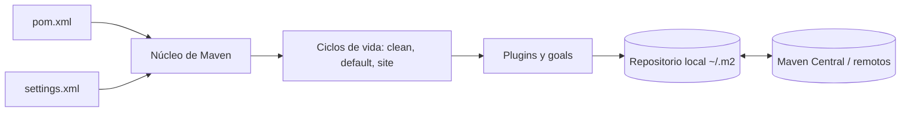

# Maven y su ciclo de vida

Apache Maven es una herramienta de **gestión y construcción de proyectos** basada en el
concepto de *Project Object Model* (POM). En lugar de describir *cómo* construir el proyecto
(como hace Ant con sus `build.xml`), el `pom.xml` describe *qué* es el proyecto: sus
coordenadas, dependencias y plugins. Maven aplica convenciones para todo lo demás.

## Arquitectura



| Elemento | Descripción |
|---|---|
| **POM** | Fichero XML con el modelo del proyecto. Hereda del *Super POM*, que define las convenciones por defecto. |
| **Coordenadas** | `groupId:artifactId:version` identifican cada artefacto de forma única (`es.ull.esit:expositotop:1.0.0-SNAPSHOT`). |
| **Repositorios** | El *local* (`~/.m2/repository`) actúa de caché; los *remotos* (Maven Central) contienen dependencias y plugins. |
| **Plugins y goals** | Todo el trabajo lo hacen plugins. Cada plugin ofrece *goals* (`compiler:compile`, `surefire:test`…). |
| **Ciclos de vida** | Secuencias ordenadas de fases. Cada fase tiene goals asociados (*bindings*). |
| **Dependencias** | Se declaran con su *scope* (`compile`, `test`, `provided`, `runtime`…) y Maven resuelve también las transitivas. |
| **Perfiles** | Configuración alternativa que se activa con `-P` (aquí, `docs`). |

## Estructura estándar de directorios

```text
ExpositoTOP/
├── pom.xml
├── src/
│   ├── main/java/          ← código de producción (antes: src/)
│   ├── main/resources/
│   ├── test/java/          ← tests JUnit (nuevos)
│   └── test/resources/     ← instancia mini.txt para tests
├── Instances/              ← datos de entrada del recomendador
└── target/                 ← salida de la construcción (no se versiona)
```

## Los tres ciclos de vida

| Ciclo | Fases principales | Uso |
|---|---|---|
| `clean` | `pre-clean`, `clean`, `post-clean` | Borrar `target/` |
| `default` | `validate` → `compile` → `test` → `package` → `verify` → `install` → `deploy` | Construir y distribuir |
| `site` | `pre-site`, `site`, `post-site`, `site-deploy` | Generar el sitio de informes |

Ejecutar una fase ejecuta **todas las anteriores** de su ciclo: `mvn install` valida,
compila, prueba, empaqueta y verifica antes de instalar.

## Fases del ciclo `default` en este proyecto

| Fase | Goals ejecutados (según el `pom.xml`) | Resultado |
|---|---|---|
| `validate` | `enforcer:enforce` | Comprueba Java ≥ 17, Maven ≥ 3.6.3 y la convergencia de dependencias |
| `compile` | `resources:resources`, `compiler:compile` | `target/classes` (con `-Xlint:all`) |
| `test` | `jacoco:prepare-agent`, `compiler:testCompile`, `surefire:test` | 43 tests ejecutados; `target/surefire-reports`, `target/jacoco.exec` |
| `package` | `jar:jar`, `source:jar-no-fork`, `javadoc:jar` | `ExpositoTOP.jar` ejecutable, `-sources.jar`, `-javadoc.jar` |
| `verify` | `jacoco:report`, `jacoco:check`, `checkstyle:check`, `pmd:check`, `pmd:cpd-check`, `spotbugs:check` | Informe de cobertura (mínimo 70 % de líneas), informes de estilo y análisis estático |
| `install` | `install:install` | Copia el JAR y el POM a `~/.m2/repository/es/ull/esit/expositotop/` |
| `deploy` | `deploy:deploy` | Publica en el repositorio de `distributionManagement` (aquí, `target/deploy-repo`) |

!!! note "Sobre `deploy`"
    `deploy` necesita un repositorio remoto. Para que pueda probarse sin servidor, el
    `pom.xml` define un repositorio en disco (`file://…/target/deploy-repo`). Para publicar en
    GitHub Packages basta con
    `mvn deploy -DaltDeploymentRepository=github::https://maven.pkg.github.com/USUARIO/ExpositoTOP`
    y un *token* en `~/.m2/settings.xml`.

## Migración del proyecto original

El proyecto se entregó como proyecto **NetBeans/Ant** (`build.xml`, `nbproject/`) con restos
de una configuración de Eclipse que apuntaba a Maven (`.classpath` con
`MAVEN2_CLASSPATH_CONTAINER`, `.settings/org.eclipse.m2e.core.prefs`) pero **sin `pom.xml`**.
También incluía artefactos compilados (`build/`, `dist/*.jar`, `dist/javadoc`) y un fichero de
copia de seguridad (`ExpositoUtilities.java~`).

Pasos realizados (ver [ADR 0001](../adr/0001-migracion-a-maven.md)):

1. Mover `src/` a `src/main/java/` conservando los paquetes.
2. Crear `pom.xml` con coordenadas, Java 17, codificación UTF-8 y plugins.
3. Añadir `src/test/java` con tests JUnit.
4. Eliminar `build/`, `dist/`, `nbproject/`, ficheros de IDE y la copia `*~`; añadir `.gitignore`.
5. Renombrar `mainTOPTW` a `MainTOPTW` (convención de nombres de clase) y declararla como
   `Main-Class` del JAR.
