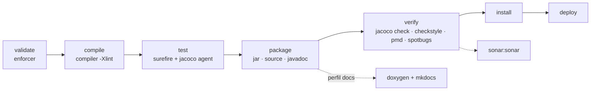

# Plugins configurados

Todos los plugins tienen la versión fijada en `<properties>` para que la construcción sea
reproducible (sin versión, Maven usa la que define el Super POM de la versión de Maven
instalada, que cambia entre versiones).

## Construcción

| Plugin | Fase | Propósito y configuración |
|---|---|---|
| **maven-enforcer-plugin** | `validate` | Impone **requisitos del entorno**: Java ≥ 17, Maven ≥ 3.6.3 y `dependencyConvergence` (todas las rutas de dependencias transitivas deben resolver a la misma versión). Evita errores difíciles de diagnosticar en máquinas mal configuradas. |
| **maven-compiler-plugin** | `compile`, `test-compile` | Compila con `<release>17</release>` (garantiza que solo se usa la API de Java 17 aunque se compile con un JDK posterior) y `-Xlint:all` con `showWarnings`, de modo que cualquier aviso del compilador aparece en la salida. |
| **maven-surefire-plugin** | `test` | Ejecuta los tests JUnit. `workingDirectory` = raíz del proyecto, porque los tests leen `Instances/TOPTW/*.txt` con rutas relativas; `redirectTestOutputToFile` evita volcar la salida del GRASP en la consola. |
| **maven-jar-plugin** | `package` | Genera `ExpositoTOP.jar` con `Main-Class: top.MainTOPTW` en el manifiesto (se ejecuta con `java -jar`) y entradas `Implementation-*`. |
| **maven-source-plugin** | `package` | Adjunta `ExpositoTOP-sources.jar` (necesario para publicar en repositorios y útil para los IDE). |
| **maven-javadoc-plugin** | `package` | Adjunta `ExpositoTOP-javadoc.jar`. `doclint` desactivado porque los comentarios usan comandos de Doxygen (`\brief`), que Javadoc trata como texto. |
| **maven-install-plugin** / **maven-deploy-plugin** | `install` / `deploy` | Versiones fijadas. El destino de `deploy` lo define `distributionManagement`. |
| **exec-maven-plugin** | bajo demanda | `mvn exec:java` ejecuta `MainTOPTW` en la JVM de Maven con `exec.args`. En el perfil `docs`, `exec:exec` lanza `doxygen` y `mkdocs build` en la fase `package`. |

## Calidad

| Plugin | Fase | Propósito y configuración |
|---|---|---|
| **jacoco-maven-plugin** | `test`, `verify` | `prepare-agent` instrumenta la JVM de los tests; `report` genera HTML, CSV y **XML** (`target/site/jacoco/jacoco.xml`, el que lee SonarQube para la cobertura); `check` **rompe la construcción** si la cobertura de líneas baja del 70 %. |
| **maven-checkstyle-plugin** | `verify` | Comprueba la guía de estilo de Google (`google_checks.xml`). Configurado como **informativo** (`failOnViolation=false`): el código mantiene la indentación de 4 espacios del proyecto original y Google exige 2. |
| **maven-pmd-plugin** | `verify` | `pmd:check` (reglas de buenas prácticas, errores probables, código muerto) y `pmd:cpd-check` (código duplicado de 100 o más *tokens*). Informativo. |
| **spotbugs-maven-plugin** | `verify` | Busca patrones de error en el *bytecode* (nulos, recursos sin cerrar, exposición de representación interna…) con esfuerzo máximo. Informativo. |
| **sonar-maven-plugin** | bajo demanda | `mvn sonar:sonar` envía el análisis a SonarQube. Las propiedades `sonar.*` del POM fijan clave, URL, versión de Java, exclusiones y la ruta del informe de JaCoCo. |

## Informes (`mvn site`)

La sección `<reporting>` añade al sitio de Maven los informes de proyecto
(`project-info-reports`), JaCoCo, Checkstyle, PMD/CPD, SpotBugs y Javadoc.

## Perfil `docs`

```bash
mvn -Pdocs package
```

Ejecuta, después de empaquetar, `doxygen Doxyfile` y `mkdocs build`. Integra la
documentación en la construcción, siguiendo el enfoque *Docs-as-Code*: la documentación se
versiona y se construye junto al código.

## Cómo contribuye cada plugin



Los plugins de calidad convierten la construcción en un **control de calidad automático**:
cada `mvn verify` (en local o en GitHub Actions) mide la cobertura, el estilo y los defectos
probables, y SonarQube agrega esas métricas en el tiempo.
